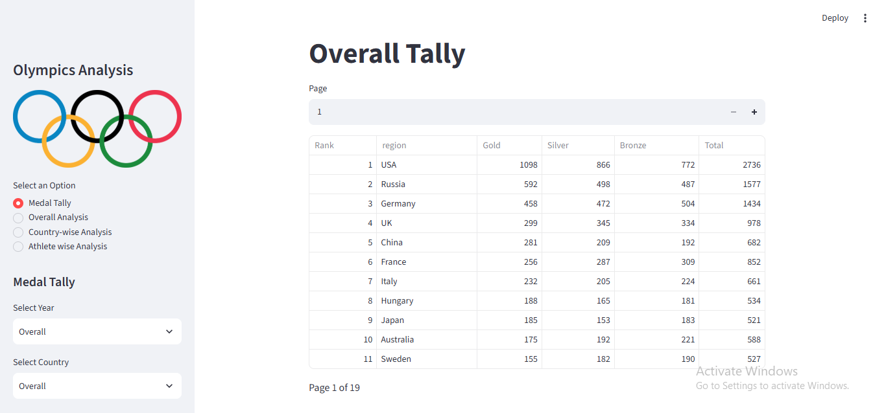
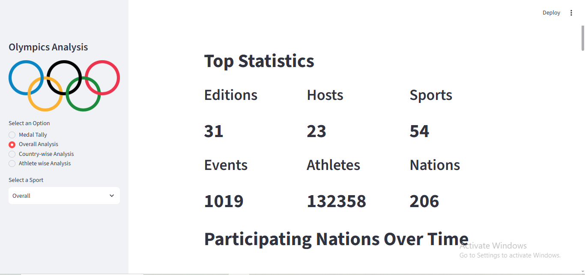
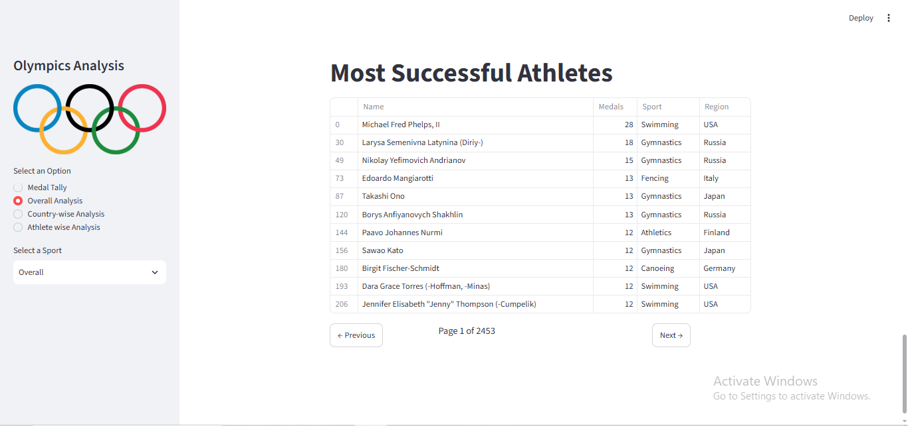
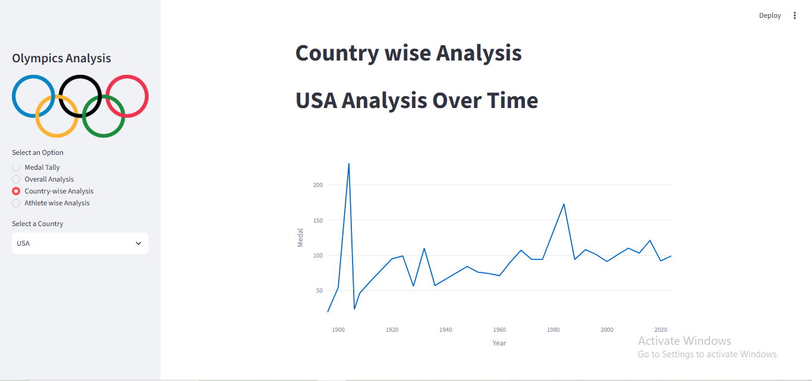
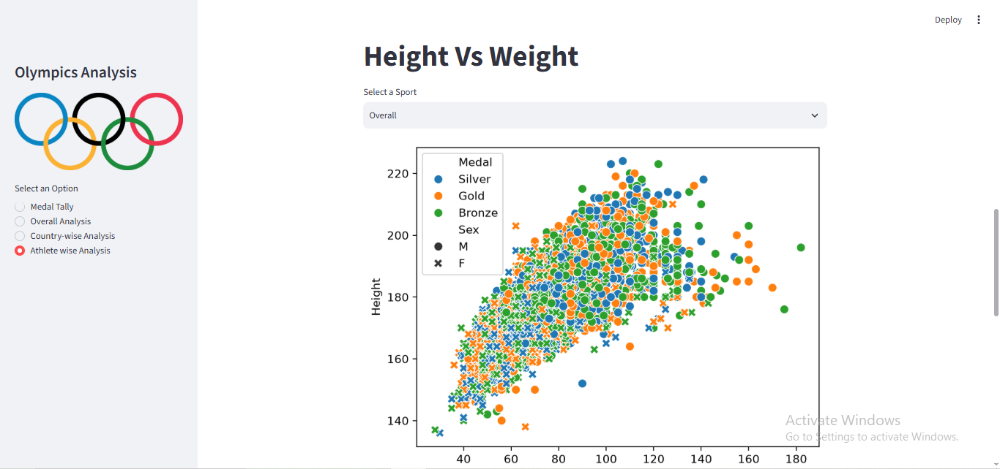
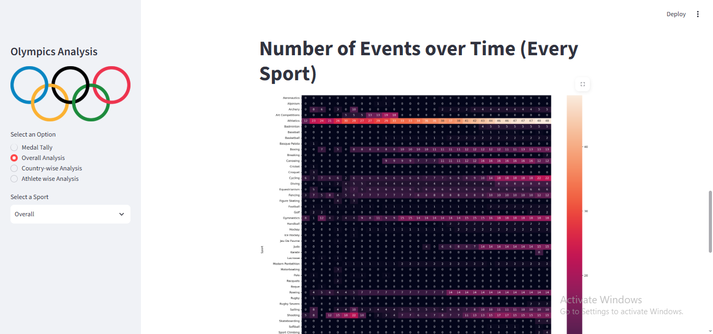

# 🏅 Olympics Data Analysis & Visualization

This project is an interactive **Olympics Data Analysis and Visualization Dashboard** built using Python and Streamlit. It explores Olympic data through different perspectives, including countries, athletes, sports, events, and medal performances.

## 📊 About the Project

The dashboard allows users to explore Olympic medal tallies, overall statistics, country-wise performance, successful athletes, athlete demographics, and participation trends over time.

It includes interactive visualizations such as line charts, heatmaps, scatter plots, and age distribution plots using Plotly, Seaborn, and Matplotlib.

The data is first preprocessed by filtering for Summer Olympics, merging country/region information, removing duplicates, and preparing medal-related data for analysis.

## 🛠️ Technologies Used

The project was developed using **Python**, with the following libraries:

- Streamlit
- Pandas
- NumPy
- Plotly
- Seaborn
- Matplotlib
- SciPy

## 🚀 Run the Project

Install the required dependencies:

```bash
pip install -r requirements.txt
```

## Web Application Preview

### Medal Tally



###  Overall Statistics



### Successful Athletes



### Country wise Analysis



### Athlete Hieght VS Weight



### Number of Events Over Time


